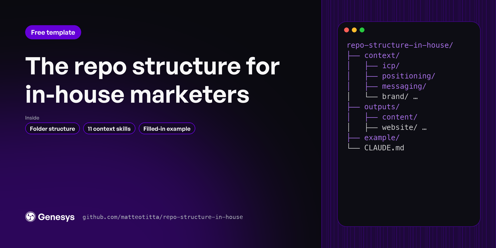

# Repo structure for in-house marketers

The folder layout that gives Claude Code your company's context before it writes anything. Fork it, fill `context/` with the five foundational skills inside, and every draft after that starts from your ICP, your positioning and your voice. You stop re-explaining your product every session.

**[Use this template →](https://github.com/new?template_name=repo-structure-in-house&template_owner=matteotitta)**

Agency or consultant with several clients? Use [repo-structure-agency](https://github.com/matteotitta/repo-structure-agency) instead.

---

## Start in three steps

1. **Create your copy.** Click *Use this template* above, or run:
   ```bash
   gh repo create my-marketing --template matteotitta/repo-structure-in-house --private --clone
   ```
2. **Open it in Claude Code** and read the example first: `example/pulse-analytics/` is a made-up B2B SaaS company with every context file filled in.
3. **Fill your context in this order.** Each skill asks for what it needs and saves into the right folder:
   ```
   /icp-research → /competitor-research → /tov-guidelines → /positioning → /messaging
   ```
   Want win-loss from your sales calls, the founder's point of view, a brand kit, a funnel or goals? Those six skills are in my [context plugin](https://maven.com/matteo-tittarelli/o/8264c5), $19.99 on Maven.

Web research works best with an [Exa](https://exa.ai) key in `.env` (copy `env` to `.env`). Without one, the skills fall back to plain web search.

---

## What's inside

```
repo-structure-in-house/
├── context/          what Claude reads first: icp, competitors, positioning,
│                     messaging, brand (your voice), docs
├── outputs/          what you ship, one folder per lane: content, website, seo-aeo,
│                     social, product-marketing, sales, paid, lifecycle, outbound
├── example/          PulseAnalytics, filled in. Read it, then delete it
└── .claude/
    ├── skills/       the five foundational context skills, plus /level
    └── rules/        one house rule: quote the source, or lower the confidence
```

Every folder has a one-page `CLAUDE.md` that says what goes there and which skill fills it.

**The idea:** `context/` is written once and kept current. `outputs/` is where work happens. Because every skill reads `context/` before it writes, a landing page, a launch plan and a LinkedIn post all come out sounding like the same company.

---

## Add skills for each lane

The five skills here build your context. When you're ready to ship work, add the plugin for that lane. Each one reads the same `context/` folder:

| Lane | Plugin | Price |
|---|---|---|
| Product launches, stories, case studies | [claude-marketing-launch](https://github.com/matteotitta/claude-marketing-launch) | Free |
| Website score, sitemap, wireframes, copy | [claude-marketing-website](https://maven.com/matteo-tittarelli/o/e6f079) | $29.99 on Maven |
| AI-answer and search visibility | [claude-marketing-aeo](https://maven.com/matteo-tittarelli/o/b376c8) | $19.99 on Maven |
| LinkedIn profile, posts, carousels | [claude-marketing-linkedin](https://maven.com/matteo-tittarelli/o/50a538) | $19.99 on Maven |
| Content strategy, long-form, newsletter | [claude-marketing-content](https://maven.com/matteo-tittarelli/o/5b9521) | $19.99 on Maven |

Want to build your own skills? Start from [gtm-skill-template](https://github.com/matteotitta/gtm-skill-template).

---

## What the full version adds

This is the free starting point: the context layer, which is layer 1 of 4. Students in [Marketing Engineering University](https://maven.com/matteo-tittarelli/marketing-engineering-university-genesys-growth) build all four on their own company:

| | Free (this repo) | Course |
|---|---|---|
| Context folders and the five foundational skills | ✓ | ✓ |
| Worked example company | ✓ | ✓ |
| The other six context skills (win-loss, founder POV, brand kit, funnel, goals, company context) | [Context plugin](https://maven.com/matteo-tittarelli/o/8264c5), $19.99 | ✓ |
| Skills for every lane, with the reference material and templates | Lane plugins: launch free, the rest $19.99 to $29.99 | The full library |
| Lanes split into research, strategy and execution | | ✓ |
| Agents, commands and hooks that chain skills and check their own work | | ✓ |
| Session memory, so each session picks up where the last one stopped | | ✓ |
| Connectors set up for your stack (Slack, Notion, CRM, analytics) | Exa only | ✓ |
| House rules for transcripts, privacy and upkeep | One | Full set |
| Live sessions and feedback on your own company | | ✓ |

The free version is enough to get your context right. That's the step most teams skip.

---

## Keep it alive

- Every file in `context/` has one owner.
- Re-run a context skill when something real changes: a new competitor, a pricing change, a new segment.
- Every 90 days, spend 30 minutes pruning anything nobody reads.

---

Built by [Matteo Tittarelli](https://www.linkedin.com/in/matteotittarelli/) at [Genesys Growth](https://genesysgrowth.com). MIT licensed: fork it, change it, use it with clients.
